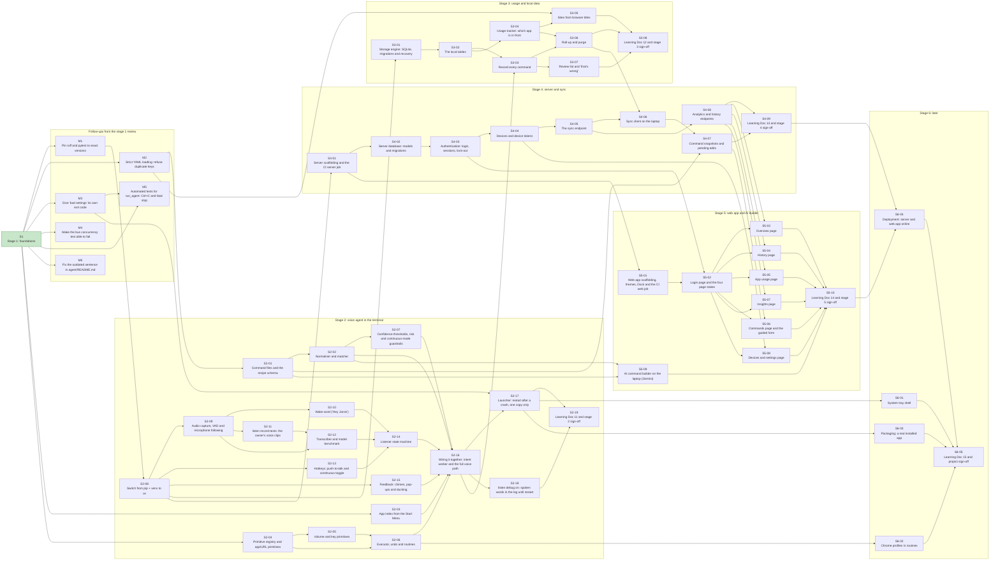

# Listen roadmap

The build plan as a **DAG** (directed acyclic graph) of GitHub issues: an arrow `A --> B` means
"B depends on A", so B cannot start before A is closed. Every node has a detailed file in
[`issues/`](issues/README.md). This file is generated from those files' "Depends on" lines: if they
change, regenerate it (ask Claude) rather than editing the diagram by hand.

**Rule:** before starting any issue, re-read its file and update it to match decisions made since.

## Ready to start now
Everything these depend on is done: M1, M2, M3, M4, M6, S2-03, S2-04.

## The graph

Green = done. Stage issues S2..S6 are the boxes; their tasks are their sub-issues on GitHub.

## Status

Fill in the GitHub number after `gh issue create`; set the status when the issue's PR is merged.

| ID | Title | Depends on | File | GitHub # | Status |
|---|---|---|---|---|---|
| S1 | Stage 1: foundations | - | [s1-foundations.md](issues/s1-foundations.md) | #4 | done (#1) |
| M1 | Pin ruff and pytest to exact versions | S1 | [m1-pin-dev-tools.md](issues/m1-pin-dev-tools.md) | #10 | todo |
| M2 | Strict YAML loading: refuse duplicate keys | S1 | [m2-strict-yaml.md](issues/m2-strict-yaml.md) | #11 | todo |
| M3 | Give "bad settings" its own exit code | S1 | [m3-exit-codes.md](issues/m3-exit-codes.md) | #12 | todo |
| M4 | Make the bus concurrency test able to fail | S1 | [m4-bus-concurrency-test.md](issues/m4-bus-concurrency-test.md) | #13 | todo |
| M5 | Automated tests for `run_agent`: Ctrl+C and fatal stop | S1, M3 | [m5-run-agent-tests.md](issues/m5-run-agent-tests.md) | #14 | todo |
| M6 | Fix the outdated sentence in `agent/README.md` | S1 | [m6-readme-fix.md](issues/m6-readme-fix.md) | #15 | todo |
| S2-01 | Command files and the recipe schema | M2 | [s2-01-command-files.md](issues/s2-01-command-files.md) | #16 | todo |
| S2-02 | Normaliser and matcher | S2-01 | [s2-02-matcher.md](issues/s2-02-matcher.md) | #17 | todo |
| S2-03 | App index from the Start Menu | S1 | [s2-03-app-index.md](issues/s2-03-app-index.md) | #18 | todo |
| S2-04 | Primitive registry and app/URL primitives | S1 | [s2-04-primitives.md](issues/s2-04-primitives.md) | #19 | todo |
| S2-05 | Volume and key primitives | S2-04 | [s2-05-volume-and-keys.md](issues/s2-05-volume-and-keys.md) | #20 | todo |
| S2-06 | Executor, undo and routines | S2-04, S2-05 | [s2-06-executor-undo-routines.md](issues/s2-06-executor-undo-routines.md) | #21 | todo |
| S2-07 | Confidence thresholds, risk and continuous-mode guardrails | S2-02 | [s2-07-thresholds.md](issues/s2-07-thresholds.md) | #22 | todo |
| S2-08 | Switch from pip + venv to uv | M1 | [s2-08-switch-to-uv.md](issues/s2-08-switch-to-uv.md) | #23 | todo |
| S2-09 | Audio capture, VAD and microphone following | S2-08 | [s2-09-audio-capture.md](issues/s2-09-audio-capture.md) | #24 | todo |
| S2-10 | Wake word ("Hey Jarvis") | S2-09 | [s2-10-wake-word.md](issues/s2-10-wake-word.md) | #25 | todo |
| S2-11 | `listen record-tests`: the owner's voice clips | S2-09 | [s2-11-record-tests.md](issues/s2-11-record-tests.md) | #26 | todo |
| S2-12 | Transcriber and model benchmark | S2-09, S2-11 | [s2-12-transcriber.md](issues/s2-12-transcriber.md) | #27 | todo |
| S2-13 | Hotkeys: push-to-talk and continuous toggle | S2-08 | [s2-13-hotkeys.md](issues/s2-13-hotkeys.md) | #28 | todo |
| S2-14 | Listener state machine | S2-10, S2-12, S2-13 | [s2-14-listener.md](issues/s2-14-listener.md) | #29 | todo |
| S2-15 | Feedback: chimes, pop-ups and ducking | S2-08 | [s2-15-feedback.md](issues/s2-15-feedback.md) | #30 | todo |
| S2-16 | Wiring it together: intent worker and the full voice path | S2-02, S2-03, S2-06, S2-07, S2-14, S2-15 | [s2-16-wiring.md](issues/s2-16-wiring.md) | #31 | todo |
| S2-17 | Launcher: restart after a crash, one copy only | M3, S2-16 | [s2-17-launcher.md](issues/s2-17-launcher.md) | #32 | todo |
| S2-18 | `listen debug on`: spoken words in the log until restart | S2-16 | [s2-18-debug-switch.md](issues/s2-18-debug-switch.md) | #33 | todo |
| S2-19 | Learning Doc 11 and stage 2 sign-off | S2-17, S2-18 | [s2-19-doc-11.md](issues/s2-19-doc-11.md) | #34 | todo |
| S2 | Stage 2: voice agent in the terminal | S1 | [s2-voice-agent.md](issues/s2-voice-agent.md) | #5 | todo |
| S3-01 | Storage engine: SQLite, migrations and recovery | S2-08 | [s3-01-storage-engine.md](issues/s3-01-storage-engine.md) | #35 | todo |
| S3-02 | The local tables | S3-01 | [s3-02-tables.md](issues/s3-02-tables.md) | #36 | todo |
| S3-03 | Record every command | S3-02, S2-16 | [s3-03-record-commands.md](issues/s3-03-record-commands.md) | #37 | todo |
| S3-04 | Usage tracker: which app is in front | S3-02 | [s3-04-usage-tracker.md](issues/s3-04-usage-tracker.md) | #38 | todo |
| S3-05 | Sites from browser titles | S3-04, M2 | [s3-05-site-extraction.md](issues/s3-05-site-extraction.md) | #39 | todo |
| S3-06 | Roll-up and purge | S3-03, S3-04 | [s3-06-rollup-and-purge.md](issues/s3-06-rollup-and-purge.md) | #40 | todo |
| S3-07 | Review list and "that's wrong" | S3-03 | [s3-07-review-and-thats-wrong.md](issues/s3-07-review-and-thats-wrong.md) | #41 | todo |
| S3-08 | Learning Doc 12 and stage 3 sign-off | S3-05, S3-06, S3-07 | [s3-08-doc-12.md](issues/s3-08-doc-12.md) | #42 | todo |
| S3 | Stage 3: usage agent and local SQLite | S1, S3-03, S2-16 | [s3-usage-and-storage.md](issues/s3-usage-and-storage.md) | #6 | todo |
| S4-01 | Server scaffolding and the CI server job | S2-08 | [s4-01-server-scaffolding.md](issues/s4-01-server-scaffolding.md) | #43 | todo |
| S4-02 | Server database: models and migrations | S4-01 | [s4-02-server-database.md](issues/s4-02-server-database.md) | #44 | todo |
| S4-03 | Authentication: login, sessions, lock-out | S4-02 | [s4-03-auth.md](issues/s4-03-auth.md) | #45 | todo |
| S4-04 | Devices and device tokens | S4-03 | [s4-04-devices.md](issues/s4-04-devices.md) | #46 | todo |
| S4-05 | The sync endpoint | S4-04 | [s4-05-sync-endpoint.md](issues/s4-05-sync-endpoint.md) | #47 | todo |
| S4-06 | Sync client on the laptop | S4-05, S3-06 | [s4-06-sync-client.md](issues/s4-06-sync-client.md) | #48 | todo |
| S4-07 | Command snapshots and pending edits | S4-06, S2-01 | [s4-07-snapshots-and-edits.md](issues/s4-07-snapshots-and-edits.md) | #49 | todo |
| S4-08 | Analytics and history endpoints | S4-05 | [s4-08-analytics.md](issues/s4-08-analytics.md) | #50 | todo |
| S4-09 | Learning Doc 13 and stage 4 sign-off | S4-07, S4-08 | [s4-09-doc-13.md](issues/s4-09-doc-13.md) | #51 | todo |
| S4 | Stage 4: server and sync | S1, S3 | [s4-server-and-sync.md](issues/s4-server-and-sync.md) | #7 | todo |
| S5-01 | Web app scaffolding, themes, Dock and the CI web job | S4-01 | [s5-01-web-scaffolding.md](issues/s5-01-web-scaffolding.md) | #52 | todo |
| S5-02 | Login page and the four page states | S5-01, S4-03 | [s5-02-login-and-states.md](issues/s5-02-login-and-states.md) | #53 | todo |
| S5-03 | Overview page | S5-02, S4-08 | [s5-03-overview-page.md](issues/s5-03-overview-page.md) | #54 | todo |
| S5-04 | History page | S5-02, S4-08 | [s5-04-history-page.md](issues/s5-04-history-page.md) | #55 | todo |
| S5-05 | App usage page | S5-02, S4-08 | [s5-05-app-usage-page.md](issues/s5-05-app-usage-page.md) | #56 | todo |
| S5-06 | Commands page and the guided form | S5-02, S4-07 | [s5-06-commands-page.md](issues/s5-06-commands-page.md) | #57 | todo |
| S5-07 | Insights page | S5-02, S4-08 | [s5-07-insights-page.md](issues/s5-07-insights-page.md) | #58 | todo |
| S5-08 | Devices and settings page | S5-02, S4-04 | [s5-08-devices-page.md](issues/s5-08-devices-page.md) | #59 | todo |
| S5-09 | AI command builder on the laptop (Gemini) | S2-01, S2-02 | [s5-09-ai-command-builder.md](issues/s5-09-ai-command-builder.md) | #60 | todo |
| S5-10 | Learning Doc 14 and stage 5 sign-off | S5-03, S5-04, S5-05, S5-06, S5-07, S5-08, S5-09 | [s5-10-doc-14.md](issues/s5-10-doc-14.md) | #61 | todo |
| S5 | Stage 5: web app and AI command builder | S4, S5-09, S2 | [s5-web-app.md](issues/s5-web-app.md) | #8 | todo |
| S6-01 | System tray shell | S2-17 | [s6-01-tray-shell.md](issues/s6-01-tray-shell.md) | #62 | todo |
| S6-02 | Chrome profiles in routines | S2-06 | [s6-02-chrome-profiles.md](issues/s6-02-chrome-profiles.md) | #63 | todo |
| S6-03 | Packaging: a real installed app | S2-17 | [s6-03-packaging.md](issues/s6-03-packaging.md) | #64 | todo |
| S6-04 | Deployment: server and web app online | S4-09, S5-10 | [s6-04-deployment.md](issues/s6-04-deployment.md) | #65 | todo |
| S6-05 | Learning Doc 15 and project sign-off | S6-01, S6-02, S6-03, S6-04 | [s6-05-doc-15.md](issues/s6-05-doc-15.md) | #66 | todo |
| S6 | Stage 6: tray, Chrome profiles, packaging, deployment | S2, S4, S5 | [s6-later.md](issues/s6-later.md) | #9 | todo |
